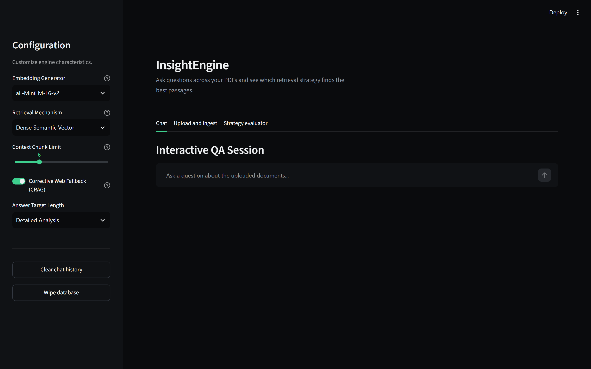
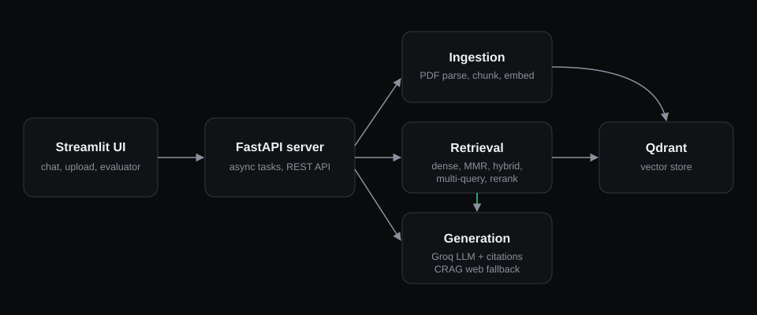
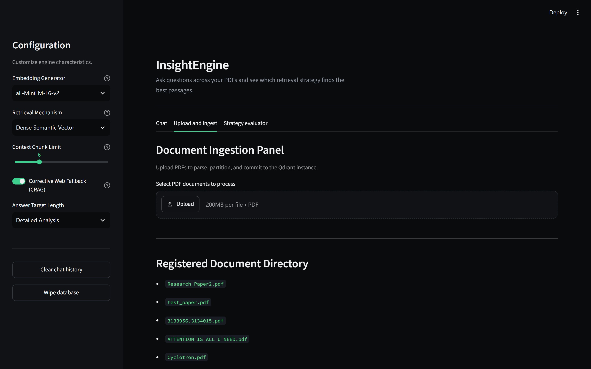
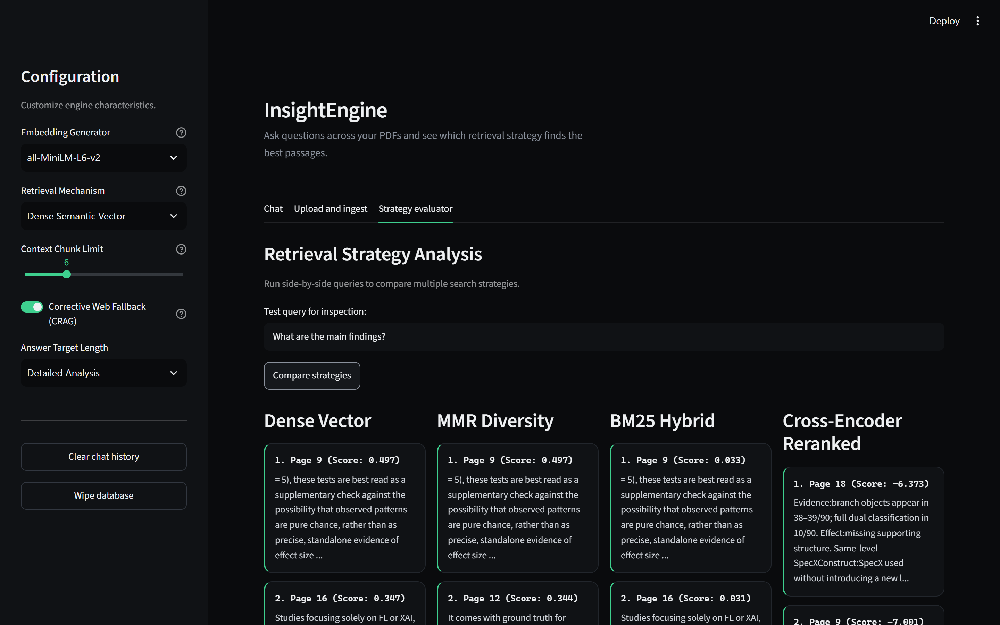

# InsightEngine: Production-Grade RAG App

Ask questions across your PDFs and get answers that cite the page they came from. InsightEngine combines a FastAPI backend, a Qdrant vector store and a Streamlit interface, and lets you compare five retrieval strategies side by side.



## Features

- **Cited answers**: every answer lists its source passages with document, page number and relevance score.
- **Five retrieval strategies**: dense vector, MMR diversity, lexical + dense hybrid (BM25), multi-query expansion, and cross-encoder reranking.
- **Corrective RAG (CRAG)**: falls back to DuckDuckGo search when local match confidence is low.
- **Async ingestion**: PDFs are parsed, chunked and indexed in the background with live progress.
- **Strategy evaluator**: run one query through several strategies and compare the passages they return.

## Architecture



| File | Role |
|---|---|
| `server.py` | FastAPI endpoints for ingestion, querying and database wipe |
| `dashboard.py` | Streamlit UI |
| `pipeline.py` | RAG coordinator, custom retriever, query expansion |
| `parser.py` | PDF parsing and embedding generation |
| `vector_db.py` | Qdrant storage layer |
| `schemas.py` | Pydantic request and response models |

## Screenshots

| Upload and ingest | Strategy evaluator |
|---|---|
|  |  |

## Quick start

```bash
python -m venv .venv
.venv\Scripts\activate        # Windows (use source .venv/bin/activate on Linux/macOS)
pip install -r requirements.txt
cp .env.example .env          # then add your Groq API key
```

Run both services (Windows):

```bash
run_app.bat
```

Or manually, in two terminals:

```bash
uvicorn server:app --host 127.0.0.1 --port 8000
streamlit run dashboard.py --server.address 127.0.0.1 --server.port 8501
```

Open http://127.0.0.1:8501.

## Stack

Python, FastAPI, Streamlit, LangChain, Qdrant, sentence-transformers (all-MiniLM-L6-v2, bge-small), Groq (Llama 3).

## Design

The UI follows [DESIGN.md](DESIGN.md), adapted from the Linear design language (VoltAgent/awesome-design-md) with a single emerald accent.

## Author

Dinesh N, B.Tech AI and Data Science. [Resume (PDF)](docs/Dinesh_N_Resume.pdf) | [GitHub](https://github.com/DINESH-7S) | [LinkedIn](https://linkedin.com/in/dineshnleo)
